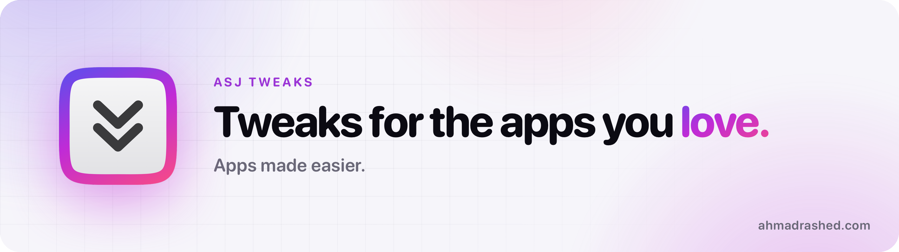

<picture>
  <source media="(prefers-color-scheme: dark)" srcset="assets/banner-dark.png">
  
</picture>

### Hi, I'm Ahmad.

iOS and web developer specializing in reverse engineering. 
I build tweaks that look native, stay fast, and hold up after every update.

[**Website**](https://ahmadrashed.com) · [**Telegram**](https://t.me/ASJTweaks) · [**X**](https://x.com/asjrxx) · [**Sponsor**](https://github.com/sponsors/asjrx)

---

### How I work

- **Taken apart first.** I learn how an app really works before I change a thing.
- **At home in the app.** Every option sits in the app's own tabs and menus, in its own style.
- **Tried before it ships.** Tested on real devices, and every file is checked against its release.

### Get the tweaks

| Installed with | Add this source |
|---|---|
| Sileo, Zebra, Cydia, Installer | `https://apt.ahmadrashed.com` |
| ESign, KSign, Feather, Scarlet | `https://source.ahmadrashed.com` |
| AltStore, SideStore | `https://altstore.ahmadrashed.com` |
| TrollStore | [ahmadrashed.com/install](https://ahmadrashed.com/install/#troll) |

Every release is posted on [Telegram](https://t.me/ASJTweaks) with what's new in it.

### Support the work

If my tweaks make your day a little better, you can [sponsor me on GitHub](https://github.com/sponsors/asjrx) or [donate](https://ahmadrashed.com/donate).
